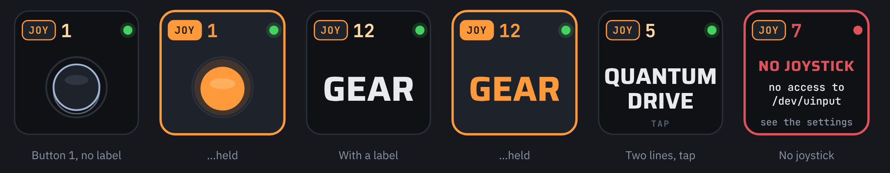
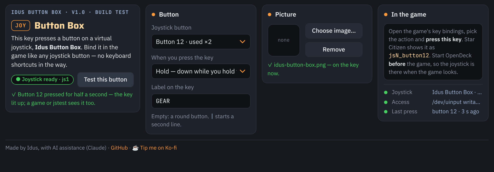
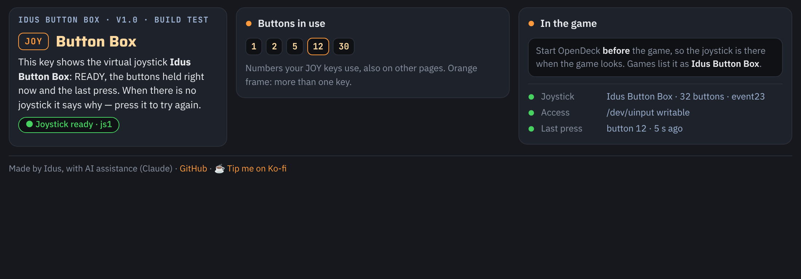

# Idus Button Box

Stream Deck keys as **joystick buttons**, for **[OpenDeck](https://github.com/nekename/OpenDeck)** on Linux. The plugin makes a virtual joystick, **"Idus Button Box"**, with 32 buttons, and each key presses one of them. Games see an ordinary joystick — under Wine/Proton too — so you bind the keys in Star Citizen, DCS, Elite and other games like any button box, with no keyboard shortcuts in the way.



## What it does

- **One key, one joystick button** (1–32). New keys get the lowest free number; change it in the settings.
- **Hold or tap.** Hold: the button is down while you hold the key — the game's own tap, hold and double-tap bindings work as usual. Tap: a short press however long you hold.
- **Your label on the key**, auto-sized, one or two lines (`|` starts the second line). No label: a round arcade button.
- **Your own picture** in the middle of the key (PNG, JPG or SVG) — the JOY tab, number and lamp stay, the label becomes a caption under it.
- **A status key, JOY · Status:** READY, the buttons held right now and the last press — or why there is no joystick (press it to try again). Its settings list the numbers your keys use.
- **You can see it work.** The key turns orange while its button is down; the green lamp means the joystick is ready.
- **No keyboard in the way.** No clashes with keyboard bindings, no modifier keys, no keyboard-layout trouble.
- **Leaves nothing behind.** The joystick exists while OpenDeck runs and is removed when it stops. No services, no system changes, no admin rights.



## Settings

| Setting | Choices | Default |
|---|---|---|
| **Joystick button** | 1 – 32 (numbers other keys use are marked) | the lowest free number |
| **When you press the key** | **Hold** — down while you hold the key · **Tap** — a short press (90 ms) | Hold |
| **Label on the key** | any text, up to 32 characters; `|` for a second line | empty (round button) |
| **Picture** | an image file — scaled to 144 px and kept in the key, so the file may move | none |

The **JOY · Status** key has no settings of its own; its panel shows the joystick, the last press and the numbers in use.



**Test this button** in the settings panel presses the button for half a second. Two keys may share a number on purpose; the button stays down until both are let go. In a multi action a key always taps. A key held for more than a minute is let go, so a lost key-up never leaves a button stuck.

## Binding it in a game

1. **Start OpenDeck before the game**, so the joystick is there when the game looks for controllers.
2. Open the game's key bindings, pick the action and **press the Stream Deck key**.
3. Star Citizen shows it as `jsN_button12` — N is the number Star Citizen gives the Idus Button Box among your joysticks.

**Your other joysticks:** Star Citizen numbers joysticks in the order it finds them at start — you cannot choose it — and the button box can land between your sticks: e.g. your left stick moves from js2 to js3 and its bindings stop working. Fix it once in the console (`§` on a Nordic keyboard, `` ` `` on US):

```
pp_resortdevices joystick 3 2
```

That moves the bindings, not the devices: every js2 binding becomes js3 and the other way round, so the stick's bindings follow it to js3. Star Citizen saves it in `actionmaps.xml`. From then on, **start OpenDeck before the game** (OpenDeck's autostart does that) — without the button box, the stick is js2 again for that session. [Idus SC Toolbox](https://github.com/Idus/idus-sc-toolbox) 1.4 warns before ▶ Launch when the button box is missing, and can move the bindings for you.

To see the joystick outside a game: KDE System Settings → **Game Controller** lists "Idus Button Box" and lights its buttons when you press the keys.

## Requirements

- **OpenDeck** 2.x and **Node.js 22 or newer** (`sudo pacman -S nodejs` on Arch/CachyOS).
- **python3** and write access to **`/dev/uinput`** — see below. Works on Wayland and X11.

Made for and tested on **CachyOS with KDE Plasma 6** and the native OpenDeck package. The OpenDeck Flatpak runs plugins in a sandbox that may block `/dev/uinput`.

## Install

One line (downloads the latest release):

```bash
curl -fsSL https://github.com/Idus/idus-button-box/releases/latest/download/install-idus-button-box.sh | bash
```

Or from a clone: `bash install-idus-button-box.sh`. Or let **[Idus GitHub Updater](https://github.com/Idus/idus-github-updater)** install it and keep it up to date — it is in its list of Idus apps.

Then **quit OpenDeck from its tray icon** and start it again. The key is under **Idus Button Box** in the action list: **JOY · Button**. The installer checks `/dev/uinput` and fetches the Idus fonts (Saira, IBM Plex Sans, JetBrains Mono) to `~/.local/share/fonts/idus` if they are missing.

### Joystick access (`/dev/uinput`)

The joystick is made through `/dev/uinput`. Steam's controller support usually allows this already — check with:

```bash
getfacl -p /dev/uinput | grep user
```

A line with your user name and `rw-` means you are set. If not, this udev rule gives the person at the computer access to it (the same way Steam does for controllers) — run it yourself; the plugin never changes system settings:

```bash
echo 'KERNEL=="uinput", SUBSYSTEM=="misc", TAG+="uaccess", OPTIONS+="static_node=uinput"' | sudo tee /etc/udev/rules.d/60-idus-uinput.rules && sudo udevadm control --reload && sudo udevadm trigger --name-match=uinput
```

No `/dev/uinput` at all: `sudo modprobe uinput && echo uinput | sudo tee /etc/modules-load.d/uinput.conf`.

Without access the keys show **NO JOYSTICK** with the reason when pressed, and a red lamp. The settings panel shows the fix and a **Try again** button.

## Use it where you are allowed to

A key presses one button, the same as a button on a real button box — no macros, no timing tricks. Some online games and competitions have rules about input devices and software; check them if you are unsure.

## How it works

- `plugin.js` — keys, numbers, hold and tap, drawing. Key numbers are kept on each key and in OpenDeck's global settings, so keys on other pages are not given the same number by mistake.
- `lib/joy.py` — the virtual joystick, Python standard library only: buttons 1–16 are `BTN_TRIGGER`…`BTN_DEAD` and 17–32 are `BTN_TRIGGER_HAPPY1`–`16`, so button N is button N in every game. Two centred X/Y axes that never move make udev, SDL and Wine treat it as a joystick; it has no gamepad buttons, so Wine never cuts it down to a 14-button gamepad. It lets go of every button and removes the joystick as soon as the plugin stops.
- `lib/joystick.js` — starts the helper with the plugin and starts it again if it stops.
- No network access, no telemetry, nothing written to disk.

## Uninstall

```bash
bash install-idus-button-box.sh --uninstall
```

## Credits

- Built for **[OpenDeck](https://github.com/nekename/OpenDeck)** by nekename.
- Same look as **[Idus SC Deck](https://github.com/Idus/idus-sc-deck)** and **[Idus Hamster Wheel](https://github.com/Idus/idus-hamster-wheel)**.
- Code written with AI assistance (Claude).

## Support

If the button box earns its place on your deck: **[☕ Tip me on Ko-fi](https://ko-fi.com/N4N2QZHKK)**

## License

MIT — see `LICENSE`. Fonts used on the key: Saira, IBM Plex Sans and JetBrains Mono (SIL Open Font License), installed separately.
